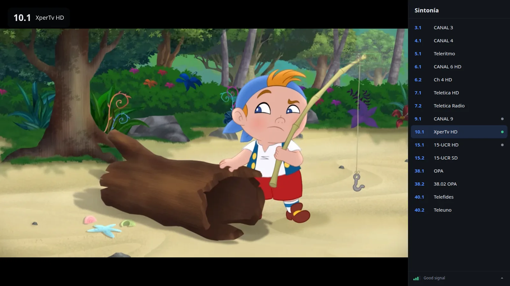
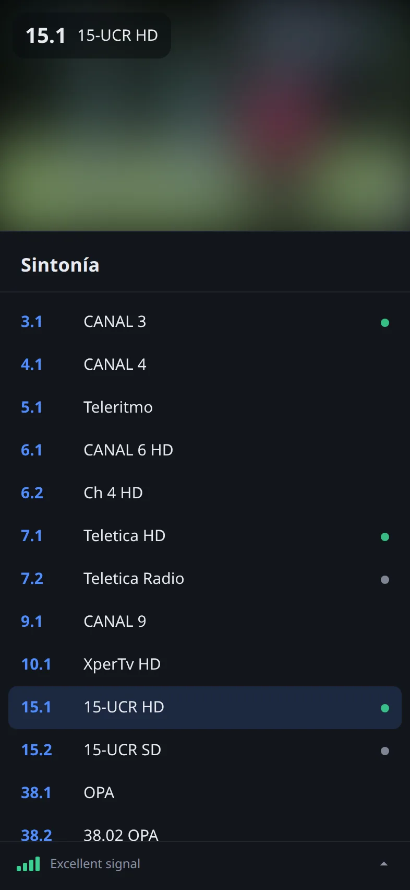

# Sintonía

[](https://github.com/kuralabs/sintonia/actions/workflows/ci.yml)
[](https://github.com/kuralabs/sintonia/actions/workflows/image.yml)

Simple, watch-TV-focused web app for live over-the-air TV. One container,
given your DVB tuners and a GPU, serves a page that plays live channels in
the browser over WebRTC, with hardware transcoding.

Open the page and the last channel you watched starts playing, the pane on
the right lists the channels, and Up/Down changes channel.

<p align="center">
  
  &nbsp;
  
</p>

- **Live, low latency**: WebRTC (WHEP) through MediaMTX, under a second
  behind the broadcast.
- **Quick channel changes**: the channels next to the one you are watching
  are kept live on spare tuners, so Up/Down takes about a second.
- **Hardware transcoding** with jellyfin-ffmpeg: interlaced 1080i becomes
  smooth 1080p60, and badly levelled channels are evened out.
- **Phones**: swipe up/down to change channel, landscape fullscreen, screen
  kept on, installable to the home screen.
- **Several viewers**: each watches their own channel; viewers of one
  multiplex share a tuner.
- **Channel scan built in**, numbering channels as a TV does.

Sintonía supports **ISDB-T** (ISDB-Tb, used across much of Latin America)
on the 6 MHz channel plan. It is built and tested with a TBS6814 quad tuner
and an NVIDIA RTX 3060 in Costa Rica; VAAPI and QSV transcoding are
supported but untested. See [docs/plan.md](docs/plan.md) for the design.

## Requirements

- **Linux with working DVB tuners**: `ls /dev/dvb` lists `adapter0` and so
  on. Some cards need their vendor's driver first.
- **Docker**, and a GPU the container can use:
  - NVIDIA: the driver and the
    [NVIDIA Container Toolkit](https://docs.nvidia.com/datacenter/cloud-native/container-toolkit/latest/install-guide.html).
  - Intel or AMD: `/dev/dri` (VAAPI or QSV).
  - No GPU: CPU transcoding works, but takes a core or more per channel.
- **Clients on the same network**: Chrome on desktop or Android. The video
  reaches them over UDP port 8189, so a firewall on the host must allow it
  (`ufw allow 8189/udp`).
- **HTTPS**, for phones (optional): keeping the screen on and installing
  to the home screen only work on HTTPS pages. See
  [HTTPS with NGINX](#https-with-nginx).

## Quick start

[examples/sintonia.sh](examples/sintonia.sh) runs everything with Docker
and keeps the configuration next to it.

1. Get the script into a directory of its own:

   ```sh
   mkdir sintonia && cd sintonia
   curl -fsSLO https://raw.githubusercontent.com/kuralabs/sintonia/main/examples/sintonia.sh
   chmod +x sintonia.sh
   ```

2. Scan for channels, about two minutes with four tuners:

   ```sh
   ./sintonia.sh scan
   mv config.scan.toml config.toml
   ```

   Every channel found is numbered as on a TV and annotated with its RF
   channel and signal quality; channels marked weak may stutter. Remove
   the ones you do not want: the order of the list is the Up/Down order.
   `./sintonia.sh scan --channels 14-51` scans fewer RF channels.

3. Add your settings at the top of `config.toml`, before the channels.
   The defaults suit one NVIDIA GPU, so you may need none:

   ```toml
   [server]
   port = 8080           # change it if 8080 is in use on the host

   [transcode]
   hwaccel = 'nvidia'    # 'vaapi', 'qsv' or 'none'
   gpu = 0               # NVIDIA: which GPU
   ```

   For VAAPI, QSV or none, also run the script with
   `SINTONIA_HWACCEL=vaapi` (or `qsv`, `none`) so the container gets the
   right devices.

4. Start it:

   ```sh
   ./sintonia.sh
   ```

   The script pulls the image, starts the container, and waits until the
   server is ready. If the server cannot start, it shows why.

5. Open `http://<host>:8080`.

To update, run `./sintonia.sh` again: it pulls the latest image and
restarts. To scan again, run `./sintonia.sh scan`: the server pauses while
the tuners scan, and the result goes to `config.scan.toml`, to merge by
hand.

## Configuration

Everything except `[[channels]]` is optional.
[examples/costa-rica.toml](examples/costa-rica.toml) is a complete
example.

| Setting | Default | |
|---|---|---|
| `server.host` | `'0.0.0.0'` | `'127.0.0.1'` behind a reverse proxy |
| `server.port` | `8080` | Web page and API |
| `tuners.adapters` | `[]` | DVB adapters to use; empty means all |
| `tuners.prewarm` | `true` | Keep the neighbouring channels live on spare tuners |
| `transcode.hwaccel` | `'nvidia'` | `'nvidia'`, `'vaapi'`, `'qsv'` or `'none'` |
| `transcode.gpu` | `0` | NVIDIA GPU index |
| `transcode.vaapi_device` | `'/dev/dri/renderD128'` | VAAPI and QSV device |
| `transcode.output` | `'1080p60'` | `'1080p60'`, `'1080p30'` or `'720p60'` |
| `transcode.video_bitrate` | `'8M'` | |
| `transcode.audio_normalize` | `true` | Even out loudness between channels |
| `mediamtx.webrtc_udp_port` | `8189` | UDP port the video reaches clients on |
| `mediamtx.webrtc_hosts` | `[]` | Extra addresses to offer clients (see below) |
| `streams.idle_timeout` | `30` | Seconds without viewers before a channel stops |

Each channel has a `number`, a `name`, the multiplex `frequency` in Hz and
the `service_id`; the scan fills them in. `sintonia import channels.conf`
converts a `dvbv5-scan` channel file instead:
`docker run --rm -i ghcr.io/kuralabs/sintonia import /dev/stdin <
channels.conf`.

## Without the script

```sh
docker run -d --name sintonia --restart unless-stopped \
    --gpus all \
    --device /dev/dvb \
    --group-add "$(getent group video | cut -d: -f3)" \
    --network host \
    -v "$PWD/config.toml:/config/config.toml:ro" \
    ghcr.io/kuralabs/sintonia:latest
```

For VAAPI or QSV, replace `--gpus all` with `--device /dev/dri --group-add
"$(getent group render | cut -d: -f3)"`. The container runs as an
unprivileged user, so `config.toml` must be readable by others. To scan,
stop the server and run `docker run --rm --device /dev/dvb --group-add
<video gid> ghcr.io/kuralabs/sintonia scan > config.toml`.

`--network host` lets WebRTC reach clients directly, and makes Sintonía's
ports the host's. Without it, publish `8080/tcp` and `8189/udp` and list
the host's LAN address in `mediamtx.webrtc_hosts`, as clients cannot reach
the container's own address.

`docker exec sintonia sintonia check` checks the set-up at any time. The
server runs the same checks at start-up and refuses to start, with a hint,
if the tuners, ffmpeg, the GPU or MediaMTX are not usable.

### NVIDIA GPUs

Pass **all** GPUs (`--gpus all`) and choose one with `transcode.gpu`:
when a container is given a single GPU other than GPU 0
(`--gpus '"device=1"'`), NVENC fails with "unsupported device". Giving one
GPU to Jellyfin and another to Sintonía works this way: pin Jellyfin to
GPU 0 (`--gpus '"device=0"'` works) and set `gpu = 1` here.

## HTTPS with NGINX

[examples/nginx.conf](examples/nginx.conf) is a complete site:

- Bind Sintonía to the loopback interface, so only NGINX reaches it:
  `server.host = '127.0.0.1'`, and the port NGINX proxies to.
- NGINX carries the page, the API, the state updates (Server-Sent Events,
  unbuffered) and the WebRTC signalling. The video does not pass through
  it: browsers receive it from Sintonía directly over UDP port 8189.
- Sintonía has no login, and every viewer can tie up a tuner. Keep it on
  your LAN or VPN, or restrict it with NGINX's `allow` and `deny`.

The certificate can come from Let's Encrypt even when the name only
resolves on your LAN (for example, a rewrite in your LAN's DNS server):
use the DNS challenge, which needs no inbound connection.

## Use

| Action | Desktop | Phone |
|---|---|---|
| Previous / next channel | Up / Down | Swipe down / up on the video |
| Fullscreen | F, double-click, or the corner button | Corner button |
| Show / hide the channel list | P, or the top-right button | Top-right button |
| Mute | M | |
| Signal details | I, or click the signal row | Tap the signal row |

Tuners are chosen automatically: a tuner already on the right multiplex,
or a free one, or one carrying only pre-warmed channels. The bottom of the
channel list shows the signal quality of the channel being watched; open
it for every tuner's signal, C/N and share of corrupt packets.

## Troubleshooting

- **The page loads but the video never starts**: the browser cannot reach
  UDP port 8189. Allow it in the host's firewall; without
  `--network host`, set `mediamtx.webrtc_hosts`.
- **The server does not start**: `./sintonia.sh` shows the end of the
  log, which says what is wrong: no tuners found, the GPU not usable, or
  an invalid configuration, with a hint.
- **A channel stutters or shows "No signal"**: open the signal details. A
  share of corrupt packets above zero means the reception is poor:
  check the antenna, cables and splitters. The scan marks weak channels.
- **Phones do not keep the screen on or offer to install**: serve
  Sintonía over HTTPS.

## Development

```sh
pip install -e '.[test,lint]'
ruff check .
pytest
```

The tests need no tuners or GPU. Code style: ruff (lint only), lines up
to 79 characters, single quotes, Sphinx-style docstrings.

## License

Copyright (C) 2026 KuraLabs S.R.L.

Licensed under the Apache License, Version 2.0. See [LICENSE](LICENSE).
